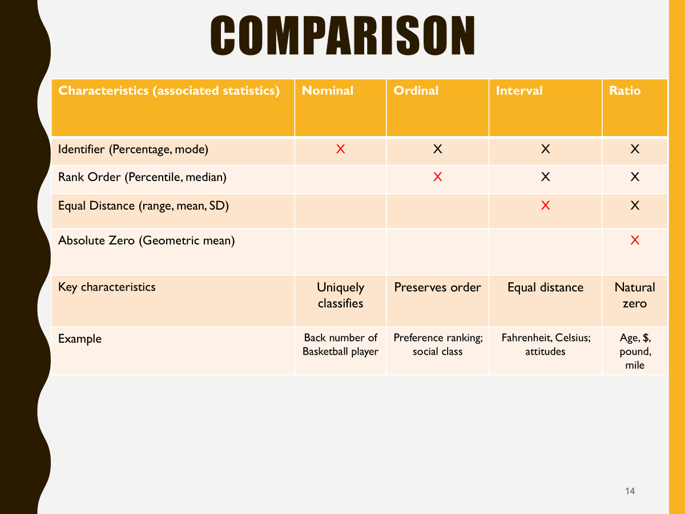

## Overview

In this assignment, you will prepare survey data for analysis using R and Quarto. The data come from Case 31, Employees Federal Credit Union. You will read an SPSS data file, inspect it, document the survey variables, clean coding problems, reverse-code selected items, and decide whether two multi-item measures can be combined into indexes.

The goal is a transparent, reproducible workflow that another analyst can follow. Read the Case 31 description and questionnaire (on Canvas or in the GitHub repository) first. The questionnaire explains what each variable means and how it is coded.

**How to work:** Each code chunk below is complete and runs as written. Run them in order, then answer the questions in your own words in the text between chunks. Replace each *Your answer:* line with your answer.

## Learning outcomes

After completing this assignment, you should be able to:

1.  Import an SPSS file into R with `haven::read_sav()`.
2.  Inspect variable names, labels, value labels, data types, and missing values.
3.  Build a basic data dictionary from SPSS metadata.
4.  Distinguish raw questionnaire variables from precomputed variables.
5.  Treat special response codes (such as "No Opinion") as missing values.
6.  Reverse-code items so that larger values have a consistent meaning, and recognize when reverse coding does not make sense.
7.  Use reliability and a one-factor analysis as quick evidence for whether a multi-item index is warranted.
8.  Create an index only when the evidence and the item meaning support it.
9.  Add, edit, and remove variable labels and value labels with the `labelled` package, using the case coding instructions.
10. Render a Quarto document to HTML and publish it on GitHub Pages.

## Files and software

Place these files in the same project folder as this QMD file:

-   `Case 31 Data_efcu_1.sav`
-   `Case 31 - Employees Federal Credit Union.PDF`

Use Positron with an R project connected to your GitHub repository. If a package is missing, install it once from the Console (never inside the document you submit):

``` r
install.packages(c("tidyverse", "haven", "labelled", "janitor", "sjPlot", "psych"))
```

The chunk below loads the packages. We call `psych` functions with the `psych::` prefix, so `psych` does not need to be loaded.

```{r}
#| label: setup

library(tidyverse)
library(haven)
library(labelled)
#library(sjlabelled)
library(janitor)
library(sjPlot)
library(psych)
library(skimr)
set_theme(theme_minimal())
```

## Four Types of Measurement Scales



## Import and inspect the SPSS data

`read_sav()` reads the SPSS file and keeps the variable labels and value labels as metadata. By default (`user_na = FALSE`), values that SPSS flags as user-defined missing are converted to ordinary `NA`.

```{r}
#| label: import
data_raw <- read_sav("Case 31 Data_efcu_1.sav")
```

Inspect the object in more than one way.

```{r}
#| label: inspect
dim(data_raw)
names(data_raw)
glimpse(data_raw)
skim(data_raw) # descriptive statistics, including missing values
summary(data_raw) # Min, Max
```

If your course materials provide `view_df()` (from the sjPlot package), you can use it in the Console to browse the labels. It opens an interactive viewer, so do not include it in the document you render.

### Questions to answer

1.  How many rows and columns are in the imported data?
2.  What are the variable names?
3.  Which variables look like questionnaire items, and which look like precomputed variables?
4.  What is the difference between a *variable label* and a *value label*?
5.  Which variables contain missing values?

*Your answer:*

Use code to support your answers. The table below counts missing values for every variable and shows only the variables that have any.

```{r}
#| label: missing-raw
data_raw |>
  summarise(across(everything(), \(x) sum(is.na(x)))) |>
  pivot_longer(everything(), names_to = "variable", values_to = "n_missing") |>
  filter(n_missing > 0)
```


## Create a data dictionary

SPSS files store metadata that is not visible in the data frame itself. `haven` keeps it as attributes. The chunk below builds a compact dictionary with each variable's label, class, number of distinct values, and value labels.

```{r}
#| label: dictionary
data_dictionary <- tibble(
  variable = names(data_raw),
  variable_label = map_chr(data_raw, \(x) attr(x, "label") %||% ""),
  class = map_chr(data_raw, \(x) class(x)[1]),
  n_distinct = map_int(data_raw, n_distinct),
  value_labels = map_chr(
    data_raw,
    \(x) {
      labs <- attr(x, "labels")
      if (is.null(labs)) "" else str_c(labs, "=", names(labs), collapse = "; ")
    }
  )
)

data_dictionary
```

Alternatively, you can use `view_df()` in the Console to browse the labels interactively.

```{r}
#| label: dictionary-easy
data_raw |> view_df()
```


### Questions to answer

1.  Which variables have clear, useful labels?
2.  Which labels should be revised for readability in your report?
3.  Which variables are nominal, ordinal, or approximately interval for this assignment? Explain at least three, using the questionnaire.
4.  Which value labels are essential for interpreting the data, and which are predictable from the response scale?

**Your answer:**

Keep `data_raw` unchanged as a reference copy. Do all cleaning on a copy.

## Improve the metadata with the case coding instructions

Labels are documentation that travels with the data. Stripping them (for example with `as.numeric()`) throws that documentation away, so we keep the labels and repair them where they are incomplete.

### Coding instructions (Case Exhibit 31.2)

| Response scale | Coding |
|------------------------------------|------------------------------------|
| Strongly disagree to strongly agree | Strongly disagree = 1; strongly agree = 5 |
| Very high to very low | Very high = 1; very low = 5; no opinion = 6 |
| Too often to never | Too often = 1; never = 5 |
| Excellent to poor | Excellent = 1; poor = 4 |
| Excellent to very poor | Excellent = 1; very poor = 5; no answer = 6 |
| Yes/no | Yes = 1; no = 2; no answer = 3 |
| Awareness/use | Aware and have used = 1; aware but have not used = 2; unaware = 3 |

The exhibit does not list question numbers. Matching it to the questionnaire: q3 to q6 and q30 to q34 are the agreement items; q7 and q8 use very high to very low; q9 is the frequency item; q10 is excellent to poor; q37 is excellent to very poor; q11, q12, q27, and q38 are yes/no; and q13 to q26 are awareness/use items.

Compare this table with the value labels you printed in Section 2. Which codes in the file have no label?

*Your answer:*

### Add, edit, and remove labels

The `labelled` package works well with the tidyverse. The main functions are:

| Task | Function |
|----------------------------------|-------------------------------------|
| Read a variable label | `var_label(x)` |
| Set variable labels | `set_variable_labels(data, q1 = "Label")` |
| Remove a variable label | `remove_var_label(x)` |
| Read value labels | `val_labels(x)` |
| Replace all value labels | `set_value_labels(data, q1 = c("No" = 0, "Yes" = 1))` |
| Add to existing value labels | `add_value_labels(x, "Unaware" = 3)` |
| Remove value labels | `remove_val_labels(x)` or `remove_value_labels(data, q1 = 1)` |
| Convert to a plain number | `as.numeric(x)` |
| Convert to a factor for display | `haven::as_factor(x)` |

A quick demonstration on a single variable (nothing is saved):

```{r}
#| label: label-demo
var_label(data_raw$q7)
val_labels(data_raw$q7)

# Add a label to one code, then strip all value labels
data_raw$q7 |> add_value_labels("Refused" = 7) |> val_labels()

data_raw$q7 |> add_value_labels("Refused" = 7)
data_raw$q7 |> var_label()
data_raw$q7 |> remove_var_label() |> var_label()
data_raw$q7 |> val_labels()
```

### Fixing Metadata Problems

The chunk below fixes the problems found by comparing the file with Exhibit 31.2. It adds the missing "unaware" and "no answer" codes and labels the two precomputed variables. 

-  Remove the two precomputed variables from the questionnaire items, because they are not part of the survey, and you don't know how it was created. Keep them in `data_raw` as a reference copy.

-  Below is an example of how to add a value label to a single variable. Use `across()` to apply it to multiple variables at once.

-  Complete for all questionnaire variables that need a label added or changed. Check the questionnaire to see which variables use the "unaware" and "no answer" codes.


```{r}
#| label: add-labels

# Agreemnet Likert Type scale value lables
five_pt_likert <- c(
  "Strongly Disagree" = 1,
  "Disagree" = 2,
  "Uncertain" = 3,
  "Agree" = 4,
  "Strongly Agree" = 5
)

data_labelled <- data_raw |>
  #select(-c(OverallEmployeePerformace, employeeperformance)) |>
  mutate(
    across(c(q3:q6, q30:q34), \(x) add_value_labels(x, five_pt_likert))
  )

# Missing "unaware" and "no answer" codes

data_labelled <- data_labelled |>
  mutate(
    across(q13:q26, \(x) add_value_labels(x, "Unaware" = 3)),
    across(c(q11, q12, q27, q38), \(x) add_value_labels(x, "No answer" = 3)),
    q37 = set_value_labels(
      q37,
      c(
        "Excellent" = 1,
        "Good" = 2,
        "Average" = 3,
        "Poor" = 4,
        "Very Poor" = 5,
        "No answer" = 6
      )
    )
  )
val_labels(data_labelled$q13)
val_labels(data_labelled$q11)
var_label(data_labelled$q37)

view_df(data_labelled)
```

Notice that q8's variable label in the file ("statement frequency") duplicates q9's label, but q8 uses the very high to very low scale. Check the questionnaire for what q8 asks. How would you relabel it with `set_variable_labels()`?

*Your answer:*


## Create an analysis copy

-   Questionnaire variables have names that start with `q` followed by a number.
-   The file also contains `OverallEmployeePerformace` and `employeeperformance`, which look like precomputed summaries. Create an analysis copy that keeps the questionnaire variables only. The labels are kept.

```{r}
#| label: analysis-copy
data <- data_labelled |>
  select(matches("^q\\d+$"))

names(data)
```

Explain why using an already computed index could be a problem when the purpose of this assignment is to evaluate and construct measures.

*Your answer:*

### Data-quality checks

Check the range of each variable against the questionnaire coding. This table lists the distinct values, the count of missing values, and the percent missing for each variable.

```{r}
#| label: quality-checks
library(gt)
data |>
  # Plain numbers are needed to stack columns that have different labels
  mutate(across(everything(), as.numeric)) |>
  pivot_longer(everything(), names_to = "variable") |>
  summarise(
    values_observed = str_c(sort(unique(value)), collapse = ", "),
    n_missing = sum(is.na(value)),
    pct_missing = round(mean(is.na(value)) * 100, 1),
    .by = variable
  ) |>
  gt()
```

Compare these values with the questionnaire. Does any variable contain a value that the questionnaire does not define?

*Your answer:*

## Recode special responses and reverse-code items

Reverse coding is needed when a larger number represents a less favorable response than a smaller number. After reverse coding, larger values should mean the same thing across all items that will be combined.

-  Fix reverse labels whenever numeric codes do not match the order of the response scale. 

  -  For example, q37 runs 1 to 5, but the labels run from "Excellent" to "Very Poor", so the labels are reversed. We want the labels to match the numeric order, so we will relabel q37 as "Very Poor" = 1 through "Excellent" = 5.

### "No Opinion" and "No answer" responses

According to Exhibit 31.2, q7 and q8 use 6 for "No Opinion", and q37 uses 6 for "No answer". Neither is a rating, so both must be treated as missing. First check whether any 6s remain in the data.

```{r}
#| label: check-no-opinion
data |>
  summarise(across(c(q7, q8, q37), \(x) sum(x == 6, na.rm = TRUE)))
```

If the count is 0, the 6s were already converted to `NA` when the file was imported (compare the missing counts in Section 1). The recode below is still good practice because it guarantees the result no matter how the file is read.

```{r}
#| label: recode-no-opinion
data <- data |>
  mutate(across(c(q7, q8, q37), \(x) na_if(x, 6)))
```

### Reverse coding

-  **List of items to reverse-code**:

  -  q7, q8, and q37: very high to very low (1 = very high, 5 = very low)
  -  q10: excellent to poor (1 = excellent, 4 = poor)
  -  Do not reverse-code q9 (frequency): The questionnaire shows that the best response for q9 is in the middle of the scale
  -  q13 to q26: These can be considered ordinal scale although they are nominal categories, strictly speaking. 
  

For a scale that runs from a minimum to a maximum, the formula is:

$$\text{reversed} = \text{minimum} + \text{maximum} - \text{original}$$

For a scale starting at 1, this equals `maximum + 1 - original`. From Exhibit 31.2, q7, q8, and q37 run 1 to 5, and q10 runs 1 to 4.

Arithmetic on a labelled variable returns a plain number, so the old labels are not carried over. That is the right behavior, because the old labels would now be wrong (for example, 1 used to mean "Very High"). We then attach new variable labels and value labels that describe the reversed direction.

```{r}
#| label: reverse-code
data <- data |>
  mutate(
    q7r = 6 - q7,
    q8r = 6 - q8,
    q10r = 5 - q10,
    q37r = 6 - q37
  ) |>
  set_variable_labels(
    q7r = "Savings rates (reversed: higher = higher rates)",
    q8r = "Rates, q8 (reversed: higher = higher rates)",
    q10r = "Statement accuracy (reversed: higher = better)",
    q37r = "Overall rating (reversed: higher = better)"
  ) |>
  set_value_labels(
    q7r = c(
      "Very Low" = 1,
      "Low" = 2,
      "Average" = 3,
      "High" = 4,
      "Very High" = 5
    ),
    q8r = c(
      "Very Low" = 1,
      "Low" = 2,
      "Average" = 3,
      "High" = 4,
      "Very High" = 5
    ),
    q10r = c("Poor" = 1, "Fair" = 2, "Good" = 3, "Excellent" = 4),
    q37r = c(
      "Very Poor" = 1,
      "Poor" = 2,
      "Average" = 3,
      "Good" = 4,
      "Excellent" = 5
    )
  )
```

Two sets of items are deliberately **not** reversed. Read the questionnaire and value labels, then answer the questions below.

-   **q9** (frequency of statements): the labels run from "Too Often" through "About Right" to "Never". The best response is in the *middle* of the scale, so the scale is not ordered from unfavorable to favorable and a simple reversal would not make the values comparable.
-   **q13 to q26** (awareness and use of products and services) have the categories "Aware and have used", "Aware but have not used", and "Unaware". These are categories, not a rating from bad to good, so a formula such as `4 - x` has no meaningful interpretation. (The yes/no items q11, q12, q27, and q38 are also categories.)


### Questions to answer

1.  Why is a reversal inappropriate for q9? How could you code q9 to answer "was the frequency about right?" instead?
2.  Why should q13 to q26 not be reversed or averaged into one score? What would be a more appropriate way to summarize them?

*Your answer:*


### Awareness Items as Ordinal Scale

**Task:** Let's suppose you want to treat awareness questions (q13 through q26) as an ordinal scale and thus want to create new variables by reverse-coding them. Write the code below

```{r}

```

### Verify the recoding

Never assume a recode worked. Compare the original and reversed values with a cross-tabulation.

```{r}
#| label: verify-recode
data |> count(q7, q7r)
data |> count(q8, q8r)
data |> count(q10, q10r)
data |> count(q37, q37r)
```

Check that:

-   "No Opinion" is missing for q7, q8, and q37;
-   the lowest original value became the highest reversed value, and the highest became the lowest;
-   missing values stayed missing; and
-   larger reversed values now mean a more favorable response.

## Evaluate candidate multi-item measures

Two groups of items may form multi-item measures:

1.  Employee proficiency: q3 through q6.
2.  Operational effectiveness: q30 through q34.

Do not create an index just because items sit next to each other in the questionnaire. Use **reliability** (Cronbach's alpha) and a quick **one-factor analysis** as evidence. This is an initial check, not a substitute for the full exploratory factor analysis you will learn later.

Statistical functions such as `psych::alpha()` expect plain numbers, so we remove the labels from the item sets only (the data keep their labels). `remove_val_labels()` strips the value labels and `remove_var_label()` strips the variable labels.

### Employee proficiency

```{r}
#| label: employee-alpha
employee_items <- data |>
  select(q3:q6) |>
  remove_val_labels() |>
  remove_var_label()

library(psych)

employee_items |> alpha()

```

```{r}
#| label: employee-fa
employee_fa <- psych::fa(
  employee_items,
  nfactors = 1,
  rotate = "none",
  fm = "minres"
)

employee_fa

employee_fa$loadings
employee_fa$communality
```

### Operational effectiveness

```{r}
#| label: operations-alpha
operations_items <- data |>
  select(q30:q34) |>
  remove_val_labels() |>
  remove_var_label()

operations_alpha <- psych::alpha(operations_items)
employee_fa

operations_alpha$total
operations_alpha$item.stats
```

```{r}
#| label: operations-fa
operations_fa <- psych::fa(
  operations_items,
  nfactors = 1,
  rotate = "none",
  fm = "minres"
)

operations_fa$loadings
operations_fa$communality
```

### Questions to answer

For each candidate measure:

1.  What is the reliability estimate (`raw_alpha`)?
2.  Do the item-total statistics (`r.drop`) suggest every item contributes? Does any item correlate weakly or negatively with the rest? If so, check its wording to see whether it needs reversing.
3.  Do the factor loadings support one common factor?
4.  Is a one-factor interpretation reasonable given the item wording?
5.  Do you recommend creating an index? Justify with both statistical evidence and substantive meaning.

**Your answer:**

Do not use a single cutoff as an automatic decision rule. Consider reliability, loadings, item wording, response scales, missing data, and the purpose of the analysis together.

## Create indexes only when justified

If your evaluation supports an index, compute each respondent's mean across the items. A mean stays on the original response scale, so it is easy to interpret. `rowMeans()` returns `NaN` for a respondent with no valid answers, so the code converts `NaN` to `NA`.

Edit this chunk to keep only the indexes you decided to create.

```{r}
#| label: create-indexes
data <- data |>
  mutate(
    employee_proficiency_index = rowMeans(pick(q3:q6), na.rm = TRUE),
    operational_effectiveness_index = rowMeans(pick(q30:q34), na.rm = TRUE),
    across(ends_with("_index"), \(x) if_else(is.nan(x), NA_real_, x))
  )
```

If you decide an index is not warranted, delete its line and explain why the items should stay separate and how you would analyze them individually.

Check the new variables.

```{r}
#| label: check-indexes
data |>
  select(ends_with("_index")) |>
  summary()
```

## Report your data-preparation decisions

Write a concise narrative that covers:

-   how the SPSS data were imported;
-   what the data dictionary showed about labels, values, and measurement levels;
-   which labels you added or corrected, and why;
-   which variables you kept or excluded, and why;
-   how "No Opinion" codes and other missing values were handled;
-   which variables you reverse-coded, which you did not, and how you verified the transformations;
-   what reliability and factor analysis suggested for each candidate measure;
-   whether you created each index, and why; and
-   any limitations or unresolved data-quality concerns.

Include tables or output that help a reader verify your decisions. Do not paste every output into the report.

**Your narrative:**
::: {.callout-note title="Data Preparation Narrative"}


:::

## Confirm Data Preparation State with Data Dictionary

```{r}
# Data dictionary with view_df()
data |> view_df()
```


## Save your work to a new SPSS file

**Instructions:** 

-  Save the cleaned data to a new SPSS file. The file name must include your initials and the word "cleaned". 

-  The new file must fix all the coding problems, including reverse coding, and improper use of missing values, variable labels, and value labels. 

-  It must also include any new indexes you created.


```{r}
#| label: save-spss
#| eval: false

data |>
  write_sav("Case 31 Data_efcu_1_cleaned.sav")
```

## Render and publish your report

Your final submission is a rendered HTML report published on GitHub Pages.

### Render locally

Save this file in your GitHub repository. In the Positron Terminal, confirm you are in the repository folder and run:

``` bash
quarto render IC-M08-Data-Preparation-Case-31-R.qmd
```

Check that:

-   all code runs without errors;
-   tables and output are readable;
-   the headings and table of contents work;
-   no local computer paths or private information appear; and
-   the report makes sense without opening the R console.

### Publish on GitHub Pages

Commit and push your QMD file and supporting files. Then publish the rendered report using the method shown in class. With Quarto's publishing command:

``` bash
quarto publish gh-pages IC-M08-Data-Preparation-Case-31-R.qmd
```

If your repository uses a different GitHub Pages workflow, follow the course instructions. Confirm the public URL opens in a browser that is not signed in to GitHub.

## Submission requirements

Submit:

1.  the QMD source file;
2.  the rendered HTML file, if your course requires it; and
3.  the public GitHub Pages URL in the Appendix below.

## Appendix: GitHub Pages link

Replace the placeholder with the full public URL of your report. The link must be clickable in the rendered HTML.

**Published report:** [View my GitHub Pages report](https://USERNAME.github.io/REPOSITORY/)

Do not leave the placeholder URL in your final submission.